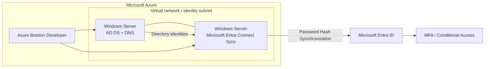

# Hybrid Identity Architecture on Microsoft Azure

## Overview

This repository documents an Azure-hosted hybrid identity architecture integrating Active Directory Domain Services (AD DS) with Microsoft Entra ID. It includes infrastructure-as-code for the Azure foundation and an implementation record for identity, synchronization, and access-security configuration.

The environment was implemented and functionally validated, including AD DS operation and synchronization of directory users to Microsoft Entra ID. The Azure resources have since been deleted to avoid ongoing charges.

## Architecture

- Azure resource group for the workload.
- Virtual network and dedicated identity subnet.
- Network Security Group associated with the subnet.
- Two Windows Server virtual machines:
  - **Directory server** — AD DS and DNS.
  - **Synchronization server** — domain-joined member server running Microsoft Entra Connect Sync.
- Azure Bastion Developer for browser-based administrative access without assigning public IP addresses to the VMs.
- Microsoft Entra Connect Sync using Password Hash Synchronization (PHS).
- MFA and Conditional Access controls tested in Microsoft Entra ID.



## Implementation outcomes

- AD DS was configured and confirmed to be functioning.
- A Windows Server member server was joined to the AD DS domain.
- Microsoft Entra Connect Sync was configured with Password Hash Synchronization.
- Directory users were created in AD DS and confirmed to appear in Microsoft Entra ID.
- MFA and Conditional Access behavior was tested.
- The Azure environment was deleted after validation to prevent further infrastructure charges.

**Policy-state note:** MFA and Conditional Access were tested during implementation. This repository does not claim that the temporary test policies remain enabled in the tenant. Screenshots of the policy settings were not retained.

## Repository structure

```text
.
├── README.md
├── docs/
│   ├── architecture.md
│   ├── implementation-and-validation.md
│   └── security-and-limitations.md
└── terraform/
    ├── main.tf
    ├── variables.tf
    ├── outputs.tf
    ├── terraform.tfvars.example
    ├── .gitignore
    └── README.md
```

## Terraform scope

Terraform reconstructs the Azure infrastructure foundation: resource group, virtual network, subnet, Network Security Group, NICs, and Windows VMs. It is a **reconstructed IaC representation**, not a recovered export of the deleted deployment or its Terraform state.

Windows guest configuration (AD DS promotion, domain join, DNS role configuration, Entra Connect installation/configuration), and tenant-side MFA/Conditional Access configuration are documented separately. They are not automatically configured by this Terraform code.

The configuration deliberately uses variables for network ranges and VM credentials. No original private IP addresses, passwords, tenant identifiers, subscription IDs, state files, or real variable files are included.

## Recreate the Azure infrastructure

> Running `terraform apply` creates billable Azure resources. Do not run it unless you intend to rebuild the environment and have reviewed the expected costs.

1. Install Terraform and authenticate to Azure with the Azure CLI (`az login`).
2. Review `terraform/variables.tf` and `terraform/terraform.tfvars.example`.
3. Provide the required values using a private `terraform.tfvars` file (not committed) or environment variables.
4. Run:

```bash
cd terraform
terraform init
terraform validate
terraform plan
terraform apply
```

5. After use, remove the recreated resources with `terraform destroy`.

## Security notes

- Never commit `terraform.tfstate`, `.tfvars` files containing credentials, passwords, private keys, or client secrets.
- Supply the VM administrator password through the `TF_VAR_admin_password` environment variable or a secret-management system.
- The VM administrator username and password must be set by the operator.
- No public IP addresses are assigned to the virtual machines.
- Review the Network Security Group rules before deployment; do not expose RDP to the public internet.
- The sample AD domain name is intentionally represented as a variable. For production, use an appropriate routable UPN suffix and follow Microsoft guidance for hybrid identity.
